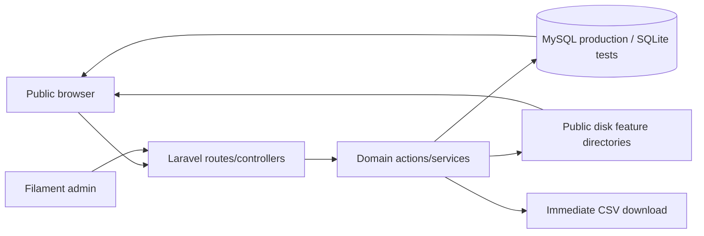

# Site Stabilization Design Specification

This specification defines the implementation-ready design for the approved site-stabilization scope. It is intended for contributors working on the Laravel/Filament application and Hostinger shared-hosting deployment. It describes target behavior, migration boundaries, verification, and rollout controls; it does not itself change application code.

## 1. Goals and non-goals

### Goals

- Accept homepage quote remarks without a 150-character limit or truncation.
- Remove application/feature throttles and rapid/duplicate guards from the approved public and operational flows while retaining authentication protections.
- Make quick chat recoverable from server history for the same browser/device for a rolling 30 days.
- Produce authorized quote/contact/referral exports synchronously without requiring a queue worker.
- Stabilize uploads through evidence-led diagnosis and Hostinger-compatible storage.
- Make the existing admin Projects feature the sole source for the homepage project section.
- Add automated and manual verification for every change, including SQLite test infrastructure.

### Non-goals

- Removing login throttling or password-reset protections.
- Removing CSRF, authorization, signed URL, file-type, size, or payload-safety controls unless a specific investigation proves the control is the failure source.
- Replacing existing internal quote/contact/referral data models.
- Guessing at the Livewire upload failure before its response is captured.

## 2. Current evidence and constraints

| Area | Verified current behavior | Design implication |
|---|---|---|
| Homepage quote | `QuoteController` validates hero `remarks` with `max:150`; quote modal `estimatedQty` also has `max:150`. `quote_requests.estimated_qty` is `string(150)`. | Change the homepage path and persisted quote field to text-capable storage; preserve input exactly after normal whitespace handling and the existing field mapping. |
| Rate limits | `routes/web.php` throttles quote submission, product data, chat messages, and admin nav counts. `QuoteController` has cache rapid-fire and `RateLimiter` duplicate guards. Livewire config exposes upload middleware. | Remove only the listed application/feature limiters. Keep login and password-reset protections. Keep non-rate safety validation such as CSRF, authorization, file constraints, and the existing 10 KB quote payload guard unless separately approved. |
| Chat | `public/static/chatwidget.js` clears `sessionStorage` on reload and stores all client state there. `ChatController` stores HMAC tokens, has no history bootstrap, and expires sessions after 24 hours. | Use durable browser storage only for the opaque token/UI hints; server history is authoritative. Add explicit inactive/terminated and expired responses. |
| Exports | Filament exporter actions currently queue jobs on the database connection; observed jobs remain at `attempts=0` without a worker. | Replace the affected actions with synchronous, streamed/download responses while preserving current authorization, filters/selections, and exporter columns. |
| Uploads | Investigated environment has no `public/storage`. `POST /livewire-d988e63b/upload-file` returns unknown HTML, but exact status/body have not yet been captured. | Upload diagnosis is a hard gate. Do not choose a storage/session/CSRF/proxy/PHP/deployment fix until the exact response and server logs are recorded. |
| Projects | `Project` currently represents an internal pipeline (`date_added`, `contractor`, `value`, `status`, `is_priority`, `encoded_by`). Homepage cards are ten hardcoded cards, including a duplicated marquee set. | Preserve internal rows in a legacy/archive table before repurposing `projects`; migrate all ten cards idempotently and make published projects the only homepage source. |
| Tests | Feature tests exist, but the current test setup does not reliably provide migrations under SQLite. | Repair test database/migration bootstrap before relying on model or endpoint tests. This is required infrastructure, not a test to skip. |

## 3. Target architecture and data flow



### Boundaries

1. **Public request boundary:** validates shape, CSRF and payload safety, then writes quote/contact/referral records. It must not apply feature throttles or duplicate suppression.
2. **Chat boundary:** accepts an opaque token in a POST body, resolves it through an HMAC digest, restores server messages, and enforces session state on every read/write.
3. **Admin boundary:** remains authorization-first. Export, project, chat termination, and upload actions must use the existing Filament policies/permissions.
4. **Media boundary:** all permanent feature images use the configured public disk and category-specific directories. URL generation must work with a storage symlink or the documented public fallback.
5. **Homepage read model:** queries `projects` for published, non-archived records ordered by `sort_order`; no hardcoded project card data remains in the view.

## 4. Detailed design

### 4.1 Quote remarks and approved rate-limit removal

- Change homepage hero `remarks` and quote-modal `estimatedQty` persistence to a text-capable quote remarks field. The least disruptive schema choice is to alter `quote_requests.estimated_qty` from `VARCHAR(150)` to `TEXT`, retaining the current export column name for compatibility.
- Remove the corresponding `max:150` validation rules. Keep `required` where currently required, string/type validation, email/phone validation, CSRF, and the existing request payload safety guard. Do not truncate in the controller, model cast, database, exporter, or UI.
- Preserve the current composition of modal quantity plus product/size context; the resulting value must be stored in full.
- Remove the quote/contact/referral route throttle, controller minimum-interaction-time and rapid-fire cache guards, and controller duplicate `RateLimiter` guard. Remove the product-data, chat-message, and admin-nav-poll throttles. For Livewire uploads, first capture the failing request under the current production configuration as required by section 4.4; only after that evidence is preserved, remove the upload endpoint's application throttle as part of the target configuration. This ordering prevents the limiter change from destroying root-cause evidence while still guaranteeing that the final feature has no upload rate limiter.
- Retain the custom admin login limiter unchanged: key by normalized email plus IP, use `SiteSettings.max_login_attempts` and `SiteSettings.lockout_minutes` (defaults 5 attempts and 15 minutes), count failed password and MFA validation, and clear on successful authentication. Retain both existing password-reset layers unchanged: route middleware `throttle:3,1` and controller key `request-password-reset:{ip}` with 3 attempts and a 300-second decay. Retain authentication, authorization, CSRF, validation, honeypot, and non-rate payload/file safety controls.

### 4.2 Quick chat persistence and termination

#### Client/server flow

The chat contract remains `POST /api/chat/messages` and carries `contractVersion: 1` in every request and response. Requests are one of: `{contractVersion:1, operation:"restore", sessionId}`, `{contractVersion:1, operation:"poll", sessionId, after}`, `{contractVersion:1, operation:"message", sessionId?:string, text, page}`, or `{contractVersion:1, operation:"handoff_requested", sessionId?:string, page}`. `sessionId` is omitted only for the first write; unknown operations or malformed fields return the normal 422 validation response without creating a session. The client/server release is coordinated; later breaking contracts increment `contractVersion` while version 1 remains supported for the release's rollback window.

1. On the first accepted guest message or handoff request, the server creates the session and returns a server-generated 256-bit opaque token. The browser stores that token under a namespaced key in same-origin `localStorage`; it does not invent a credential. “Same browser/device” means the same browser profile and origin with that `localStorage` entry intact. Private-browsing cleanup, site-data deletion, a different browser/profile/device, or an origin change does not restore the session.
2. On page load, tab restore, or browser restart, the widget sends a `restore` request with the token. Restore returns the complete retained guest/staff message history, session mode/state, and expiry timestamp. After that bootstrap, polls send the greatest rendered message ID and return only later messages. Server history, not a cached transcript, is authoritative.
3. `last_activity_at` is updated only by a successfully committed guest message/handoff request or staff message. Each such write atomically sets `expires_at = last_activity_at + 30 days`. Page loads, restore/poll requests, panel open/close, failed writes, admin viewing, and the claim/termination actions do not extend expiry; passive polling therefore cannot keep a chat alive forever. The boundary is precise: the session is active while `now() < expires_at` and expired when `now() >= expires_at`.
4. The browser renders returned messages with text content APIs and may cache a bounded display copy only as an optimization. Refresh and tab close must not clear the durable token.
5. A missing token means “no existing session” and leaves the widget ready to create one on the first write. An unrecognized token returns `CHAT_INVALID` (404); an expired token returns `CHAT_EXPIRED` (410) without guest-accessible history; a terminated token returns `CHAT_TERMINATED` (410) with the retained history in that response. For any of these terminal responses, the client clears only namespaced chat keys. For termination it first renders the returned history read-only in the current page and disables the composer; a later page load shows a fresh-chat state. A new session is created only after a new guest write, never automatically by a failed restore/poll.

#### Data/state changes

- Retain HMAC-at-rest token lookup and POST-body transport. Add `last_activity_at`, `terminated_at`, and nullable `terminated_by`; retain `expires_at`. State is derived in this precedence order: `terminated_at != null` is terminated; otherwise `now() >= expires_at` or `revoked_at != null` is expired/invalidated; otherwise active. `is_active` and the existing assignment workflow status may remain for queue display, but neither may override those terminal predicates. Index `expires_at` and `terminated_at`; foreign-key `terminated_by` to users with `nullOnDelete` so the timestamp remains the audit fact.
- Backfill existing non-terminated sessions with `last_activity_at = COALESCE(last_message_at, created_at)` and `expires_at = last_activity_at + 30 days`. Preserve already revoked sessions as invalidated; the migration must not reactivate them.
- Do not delete messages when an admin terminates a session. Termination makes the session read-only to the guest and keeps server history visible to authorized staff.
- Guest writes to terminated sessions return HTTP 410 with `{contractVersion:1, status:"terminated", code:"CHAT_TERMINATED", messages:[...]}` and do not mutate a message or activity timestamp. Expired sessions return HTTP 410 with `{contractVersion:1, status:"expired", code:"CHAT_EXPIRED", messages:[]}`. Invalid tokens return HTTP 404 with `{contractVersion:1, status:"invalid", code:"CHAT_INVALID", messages:[]}`. Active restore/poll responses are HTTP 200 with `{contractVersion:1, status:"active", expiresAt:<ISO-8601>, messages:[{id,sender,text,agentName,createdAt}]}`. Successful writes return the same lifecycle fields; successful session creation additionally returns `sessionId`. The token never appears in a URL or log context. All responses use `Cache-Control: no-store`.
- Add an authorized admin termination action. It must be idempotent, audit the actor, set inactive/terminated state, and prevent subsequent guest writes even if the token is replayed.
- Keep browser/device scope: no account-wide identity or cross-device transcript association is introduced.

### 4.3 Synchronous exports

- Replace the three affected Filament export actions (quote requests, contact messages, referrals) with an action/service that executes the current authorized query synchronously in the initiating HTTP request. This deliberately avoids Laravel export jobs, queue tables, polling, and a resident worker, all of which are unsuitable prerequisites for the Hostinger shared-hosting deployment.
- Header names and columns remain the current exporter columns. Current table filters and selected-record semantics must remain intact; bulk export must never bypass the table authorization scope.
- Iterate the authorized query by primary key in chunks of 500 and write CSV rows with `fputcsv` to a request-scoped temporary file under a writable non-public `storage/app/tmp/exports` directory. Only after the file closes successfully may ownership pass to a binary download response configured to delete it after send; exception paths before that transfer delete it during error cleanup. This keeps PHP memory bounded, prevents a serialization failure after download headers from masquerading as a complete file, and uses only filesystem/PHP capabilities available on shared hosting. The response must set a deterministic `<resource>-YYYYMMDD-HHMMSS.csv` filename, UTF-8 CSV, `text/csv`, attachment disposition, and no-store headers.
- On authorization/query/serialization/temp-file failure, delete any temporary artifact, log a correlation ID, and show an actionable admin notification: export failed and the admin can retry. Do not begin a download and do not silently fall back to a queued job. A client disconnect may still yield a browser-level incomplete transfer, but the server must not retain the temporary file.
- Existing export tables/jobs may remain only if no longer used by these actions; no persistent worker is a deployment prerequisite.
- Before production enablement, export each resource at the larger of 10,000 rows or twice its deployment-time production row count in a Hostinger-equivalent environment. It must complete within the host's configured request timeout and memory limit. Failure blocks rollout and is resolved by reducing per-row query cost or chunk size, not by restoring queue dependence or loading all rows into memory.

### 4.4 Upload infrastructure and investigation gate

#### Required first investigation

Before changing upload middleware, disks, paths, session/CSRF settings, PHP settings, proxy rules, or deployment caches, reproduce the Livewire request under the current production configuration and record:

- exact HTTP status, response headers, content type, and complete response body for `POST /livewire-d988e63b/upload-file`;
- request method, URL, CSRF header/cookie presence, signed URL/token inputs, authenticated session state, and file metadata (name, MIME, byte size);
- Laravel, PHP-FPM, web-server/proxy, and Hostinger logs at the same timestamp;
- whether the response is generated by Laravel, Livewire, the proxy, PHP, or a hosting error page.

This unresolved root cause is an **investigation gate**, not permission to guess. The correction must be selected from evidence among storage permissions/disk configuration, session or CSRF handling, signed URL generation, proxy/web-server routing, PHP limits/version, or deployment/cache mismatch.

The evidence artifact must identify the timestamp, affected admin action and field, request/response capture, correlated log lines, diagnosed producing layer, and the single supported root-cause conclusion. No upload fix—including removal of the Livewire upload throttle—may be implemented before this artifact is reviewed. Unrelated quote/chat/export/project work may proceed while this gate is open; upload implementation and upload rollout may not.

#### Target upload behavior after diagnosis

- Configure public-disk feature directories for `categories`, `blog`, and `projects` (and the temporary upload directory as required by the diagnosed Livewire path).
- Accept only JPG/JPEG, PNG, and WebP; enforce a maximum of 5 MB at both UI and server/action boundaries. Reject invalid type/size with a field-level, actionable message naming the accepted formats and limit.
- Disable the Filament Create action while an upload is in progress, and add a server/action guard that refuses creation without a completed valid upload.
- Ensure permanent paths are predictable, non-executable media paths and old files are not deleted until the new record is committed successfully.
- Hostinger deployment must document writable `storage`, cache/session directories, and public media directories. If `public/storage` symlinks are unavailable, serve a controlled public fallback route/path with equivalent authorization and URL generation; do not expose arbitrary private storage.

### 4.5 Public projects

#### Target fields

The repurposed public `projects` record contains:

| Field | Type/constraint | Behavior |
|---|---|---|
| `tag` | string, nullable | Public category label. |
| `image` | string, required | Web-relative `/static/images/...` path for imported cards or configured public-disk path for managed uploads; JPG/PNG/WebP, <=5 MB for uploads. |
| `location` | string, nullable | Escaped public location text. |
| `title` | string, required | Escaped public title. |
| `info` | text, nullable | Escaped public description. |
| `is_published` | boolean, default false | Controls homepage visibility. |
| `sort_order` | integer, default 0 | Ascending homepage order; use ID as deterministic tie-breaker. |
| `created_at`, `updated_at` | timestamps | Normal model timestamps. |
| `deleted_at` | timestamp, nullable | Soft-delete/archive; excluded from public query. |
| `migration_key` | string, nullable, unique | Hidden immutable key used only for idempotent import of the ten static cards. |

Add a composite public-read index on `(is_published, deleted_at, sort_order, id)`.

Before dropping old pipeline columns, create `legacy_projects_20260918` with `original_project_id` as a unique key, every legacy scalar (`date_added`, `contractor`, `project_name`, `value`, `status`, `is_priority`, `encoded_by`, `created_at`, and `deleted_at`), plus `archived_at` and `source_checksum`. Compute `source_checksum` as lowercase SHA-256 of a UTF-8 JSON array in exactly that listed field order, using `YYYY-MM-DD` for the date, two-decimal fixed-point text for value, UTC ISO-8601 text for timestamps, JSON booleans, and JSON nulls. Copy all rows, including soft-deleted rows, with an upsert keyed by `original_project_id`. Re-running the copy updates only a changed checksum/payload and cannot duplicate a row.

The destructive schema step is gated by reconciliation in the same deployment procedure: source count including trashed rows equals archive count; every source ID exists once; and every recomputed source checksum equals its archive checksum. Any mismatch throws and stops before an old column is dropped. Because MySQL DDL can commit implicitly, use separate archive/copy, verify, and schema-conversion migrations; do not claim transaction rollback protects the destructive step. No old row may disappear silently. After verification, the live schema and model/admin resource move entirely to the public fields. The legacy table remains read-only and is not automatically dropped; deletion requires a separately approved retention decision after stabilization.

#### Migration and homepage behavior

- Seed/migrate exactly the ten first-set cards currently in `home.blade.php`, in their current order, with immutable keys `homepage-legacy-01` through `homepage-legacy-10`. Upsert by `migration_key`, set `sort_order` 1 through 10, and copy each card's tag, image path, location, title, and info verbatim; publish all ten. Re-running updates those keyed records without adding an eleventh record and does not match on editable title/image text. Preserve the existing static image paths initially; the image URL resolver must support both these `/static/images/...` paths and later public-disk paths without requiring an immediate upload.
- The admin resource supports create/edit, image preview, search, sort, publication toggle/filter, preview, soft-delete/archive, restore, and permanent deletion according to existing authorization.
- The homepage controller queries `where is_published = true`, excludes soft-deleted rows, and orders by `sort_order`, then `id`.
- Render one current marquee and one exact duplicate with `aria-hidden="true"`; duplicate images use empty alt text while current images use meaningful escaped alt text derived from title/context. Escape all database text. If the result is empty, omit the entire section.

## 5. Error handling and security

| Failure | Required response |
|---|---|
| Oversized/invalid quote payload | Existing payload error or validation error; never truncate remarks. |
| Invalid upload | Field-level validation with format/size guidance; no record creation. |
| Upload infrastructure failure | Correlation ID, actionable admin error, diagnostic log; preserve the captured root cause. |
| Expired chat | HTTP 410 `CHAT_EXPIRED` with no guest history; client clears only namespaced chat keys and presents fresh-chat state. |
| Terminated chat write | `CHAT_TERMINATED`; no message or activity timestamp mutation. |
| Unauthorized export/project/chat action | Existing authorization response; no data or file disclosure. |
| Export failure | Correlation ID and retryable notification; no misleading partial download. |

Removing feature rate limits increases abuse exposure. Compensating controls are validation, CSRF, honeypot, authorization, payload/file caps, audit logging, monitoring, and operational review. Login and password-reset throttles remain mandatory. Chat tokens remain HMAC-hashed at rest, are not placed in URLs, and are sent only in POST bodies.

## 6. Dependency graph and critical path

```text
Test SQLite/migration bootstrap
        |
        +--> Quote schema/controller + limiter removal --> quote tests
        +--> Chat state/history schema/API/client --------> chat tests
        +--> Synchronous export service ------------------> export tests
        +--> Upload evidence gate --> root-cause fix ------> upload tests
        +--> Legacy project archive --> public schema/data migration
                                      --> admin resource
                                      --> homepage query/view
```

Critical path has three gates: repair test infrastructure before feature verification; capture/classify upload evidence before the upload correction; and reconcile the legacy project archive before project schema conversion. Quote, chat, export, upload evidence capture, and project archive-copy work may otherwise proceed in parallel. Final integration waits for each affected branch's gate and tests, then completes project UI/homepage wiring and deployment verification.

Execution dependencies are: (1) SQLite migration bootstrap before feature tests; (2) quote column migration before long-remark writes; (3) chat schema/backfill before deploying the new client contract; (4) export service before replacing any Filament action; (5) upload evidence review before any upload correction or upload-throttle removal; and (6) project archive copy and reconciliation before schema conversion, followed by ten-card import before removing hardcoded cards. Quote, chat, export, and the project archive-copy phase may proceed in parallel; the upload evidence capture may also proceed in parallel but its correction remains gated.

## 7. Acceptance criteria

1. A homepage quote with more than 150 characters is accepted, stored in full in a text-capable field, exported in full, and displayed in admin without data truncation.
2. Quote/contact/referral submissions, quote product-data requests, chat POSTs, admin nav polling, Livewire uploads, and quote rapid/duplicate guards have no application/feature rate limiter. Admin login and password-reset protections still throttle and are covered by regression tests.
3. Chat survives refresh, tab close, and browser restart in the same browser profile/origin while its durable token remains; server history restores after client transcript deletion. Only committed guest/staff messages or handoff requests roll expiry forward exactly 30 days; restore/poll and UI activity do not.
4. Invalid and expired chat tokens produce explicit states. Admin termination marks the session inactive/terminated, blocks guest writes, retains server history, and causes the next guest request/poll to return that history with `CHAT_TERMINATED`. The client renders that final history read-only for the current page, clears only namespaced chat keys, and shows fresh-chat state on the next page load; it does not auto-create a replacement session.
5. Authorized quote/contact/referral exports download immediately, preserve current columns and filter/selection authorization, work without a queue worker, and report failures clearly.
6. The upload root cause is documented with exact status/body/headers/log evidence before the fix. Final uploads accept only JPG/PNG/WebP up to 5 MB, use public feature directories, disable Create during upload, enforce a server/action guard, and show actionable failures on Hostinger with symlink fallback documented.
7. No upload data is silently lost; storage/session/CSRF/signed URL/proxy/PHP/deployment changes are tied to the captured evidence.
8. All ten static homepage cards are migrated idempotently, initially preserving image paths. Existing internal project rows, including soft-deleted rows, are archived with exact ID, count, and SHA-256 reconciliation before old columns are dropped.
9. Admin Projects manages the specified fields, preview/search/sort/publication/archive behavior. Homepage output contains only published, non-archived records in `sort_order`, safely escaped, with meaningful alt text, an `aria-hidden` duplicate marquee, and no section when empty.
10. Automated tests run against a working SQLite schema with migrations; manual verification covers every item above on a production-like Hostinger deployment.

## 8. Verification strategy

### Automated

- Migration bootstrap test: every database-touching feature test uses Laravel's migration-refresh mechanism; a fresh SQLite database runs the full migration set successfully, including foreign keys and soft deletes. `php artisan test` is the required full-suite command and must exit zero before rollout.
- Quote feature tests: long remarks, modal context composition, no truncation, validation, and no rate-limit/duplicate rejection; login/password-reset throttle regression tests.
- Chat feature tests: server-generated token creation, complete restore then incremental poll, exact 30-day boundary with frozen time, no expiry extension from polls, same-origin durable-key client behavior, invalid/expired contracts, terminated final-history/read-only cleanup behavior, no guest writes, idempotent termination, and admin authorization/audit.
- Export tests: filtered and bulk scopes, exact headers/columns, deterministic filename/headers, 500-row chunk traversal without duplicates or omissions, no queued job creation, authorization denial, temporary-file cleanup after success/failure, and simulated pre-download failure handling.
- Upload tests: allowed MIME/size, rejection at 5 MB boundary, Create guard, directory/path selection, and diagnosed endpoint response contract. The exact production HTML failure remains a manual evidence artifact, not a guessed fixture.
- Project migration/model/view tests: all legacy and soft-deleted rows copied with matching IDs/counts/checksums before conversion; a forced mismatch blocks destructive migration; two runs still produce exactly the ten migration keys; static and public-disk image URL resolution; public query ordering/index behavior; archive exclusion; escaping; duplicate marquee accessibility; and empty-section omission.

### Manual

1. Submit a 151+ character homepage remark and compare submitted text, database value, admin display, and CSV.
2. Repeat approved public flows rapidly and confirm normal validation/CSRF behavior without feature-throttle or duplicate-guard responses.
3. Start chat, close/reopen tab, restart browser, clear only cached transcript, poll after staff reply, terminate as admin, then attempt guest write.
4. Export filtered and selected records with no worker running; verify download, columns, filename, and failure notification.
5. Reproduce and capture the upload HTML response before fix; upload each allowed/invalid file type and size; test Create-disabled and server guard behavior.
6. Create, preview, search, sort, publish, archive, restore, and unpublish projects; verify homepage and accessibility behavior at zero, one, and multiple records.
7. Deploy to Hostinger with and without a storage symlink, verify writable paths, cache/session behavior, public media URLs, CSRF, signed URLs where used, and PHP/web-server logs.

## 9. Rollout, rollback, and Hostinger assumptions

### Rollout

1. Back up the database and media; record current project row count and the ten static card definitions.
2. Deploy test-infrastructure changes. In a maintenance window, run the project archive/copy migration, persist its reconciliation output, and stop on any mismatch before running schema conversion and ten-card import. Back up again after successful conversion.
3. Deploy database-compatible code in this order: quote schema before long-remark controller validation; chat schema/backfill before the coordinated API/client release; export service before action replacement; project schema/import before the homepage switches to database reads. Keep the projects section hidden until the ten imported rows reconcile. Deploy the upload correction and remove its upload throttle only after the evidence gate is signed off.
4. Run smoke tests and inspect logs, failed jobs, filesystem permissions, and download responses. A queue worker is not required for the final export path.

### Rollback

- Revert application release only to a database-compatible release and only after preserving new quote text, chat history, uploaded media, and migrated project rows. Forward-fix additive/data migrations; do not restore a release that writes a 150-character quote column or understands only 24-hour chat expiry.
- Do not reverse the project schema or delete `legacy_projects_20260918` during stabilization. If homepage rendering fails, disable/omit the projects section while retaining database and archive rows; do not keep or reintroduce hardcoded cards in the target release. Restoring the pre-change application requires restoring the pre-change database backup as a coordinated maintenance rollback, not running a destructive down migration against new data.
- If uploads fail, disable the Create action and preserve diagnostic evidence; do not broaden MIME, size, permissions, or public exposure as an emergency workaround.
- Chat termination is irreversible as a guest-write state; rollback must preserve read-only history and audit records.

### Hostinger assumptions to verify during deployment

- PHP version and required Laravel extensions match the application lockfile/runtime.
- Document root, rewrite rules, HTTPS, trusted proxy behavior, upload/request limits, and PHP-FPM error logging are available.
- `storage`, framework cache/session paths, and public media directories are writable by the web process.
- `public/storage` symlinks may be unavailable; the approved fallback must be a deliberate media path/route, not a broad storage directory exposure.
- Database migrations can run once with a backup and enough execution time; if not, use the project’s supported release/migration procedure without skipping reconciliation.

## 10. Requirement traceability

| Approved requirement | Design contract | Verification / rollout gate |
|---|---|---|
| Long homepage remarks without truncation | 4.1 | Acceptance 1; quote automated/manual tests |
| Remove feature limiters but retain auth/password-reset limits | 4.1 exact remove/retain lists | Acceptance 2; limiter regression tests |
| Same-browser chat persistence for rolling 30 days | 4.2 token scope, activity boundary, API states | Acceptance 3–4; frozen-time and browser tests |
| Precise admin termination | 4.2 state precedence and 410 contract | Acceptance 4; idempotency/audit/write-block tests |
| Synchronous Hostinger-compatible exports | 4.3 bounded-memory temporary-file path, no worker | Acceptance 5; Hostinger-equivalent capacity gate |
| Evidence-led upload fix | 4.4 hard gate and evidence artifact | Acceptance 6–7; gate sign-off before implementation |
| Preserve legacy project data | 4.5 archive schema and reconciliation | Acceptance 8; mismatch must halt migration |
| Idempotently migrate ten cards and use Projects as sole source | 4.5 immutable keys/query/render rules | Acceptance 8–9; two-run migration and view tests |
| Working SQLite tests, dependencies, critical path, rollout/rollback | Sections 6, 8, and 9 | Acceptance 10; ordered deployment and smoke tests |

## 11. Architecture decisions

### ADR-01: Keep a modular Laravel monolith

**Decision:** Implement these changes inside the existing Laravel/Filament deployment with explicit controller/service/model boundaries. **Reason:** Shared hosting, current scale, and the need for a low-risk stabilization release do not justify distributed services. **Tradeoff:** Independent scaling is limited, but deployment and operations remain simple.

### ADR-02: Server-authoritative chat with a durable opaque browser credential

**Decision:** Persist only the HMAC-protected session credential and UI hints in same-origin browser storage; persist authoritative history and lifecycle state in MySQL. **Tradeoff:** Site-data deletion loses guest access, intentionally avoiding account/cross-device identity and client-transcript trust.

### ADR-03: Synchronous exports via a request-scoped temporary file

**Decision:** Build the authorized CSV synchronously in bounded chunks, then send the completed file. **Tradeoff:** The request remains subject to Hostinger execution limits, addressed by the explicit capacity gate; in return, exports need no unreliable background worker and pre-download failures cannot produce apparently complete partial files.

### ADR-04: Archive-then-convert Projects

**Decision:** Preserve and reconcile every legacy row in a versioned read-only table before converting `projects` and importing the ten immutable-keyed public records. **Tradeoff:** The legacy table temporarily duplicates data, but supplies auditable rollback evidence and avoids silent loss.

## 12. Decisions fixed for implementation

- The upload correction is intentionally not selected until evidence satisfies the gate; this is a required decision point, not an implementation placeholder. All behavior and selection criteria on either side of that gate are defined above.
- No other design choice remains open: implementation must use the state contracts, migration keys, archive/reconciliation process, synchronous export path, and rollout order specified here. A newly discovered production constraint that conflicts with them requires a reviewed specification amendment before implementation proceeds.
